

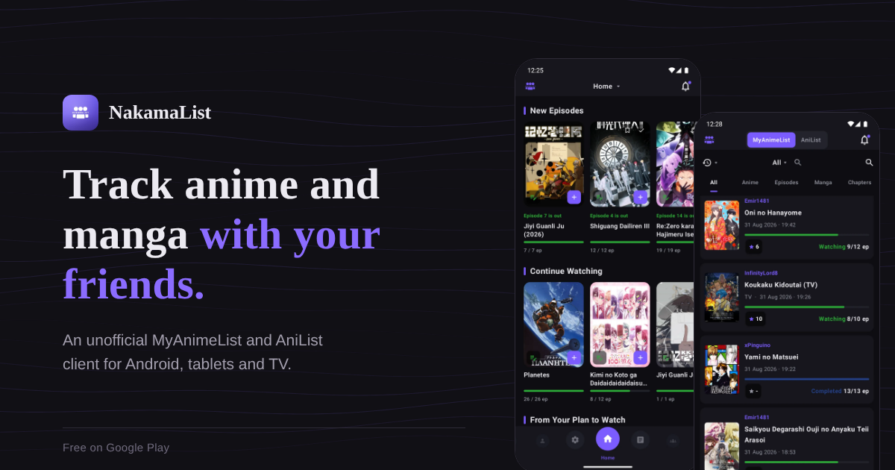

 

**An unofficial MyAnimeList (MAL) client for Android, for anime and manga.**

Keep your list up to date, see what your friends are watching, 
and how they rated the show you just finished.

 

<a href="https://play.google.com/store/apps/details?id=com.nakamalist.app">
  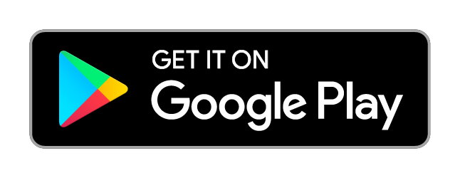
</a>

 

[Screenshots](#screenshots)&nbsp;&nbsp;·&nbsp;&nbsp;[Features](#features)&nbsp;&nbsp;·&nbsp;&nbsp;[Download](#download)&nbsp;&nbsp;·&nbsp;&nbsp;[Support](#support)

> [!NOTE]
> **Not affiliated with MyAnimeList or AniList.** NakamaList is an independent, unofficial client.
> Sign-in and all reading and writing happen through those services' official APIs, with your own
> account and only your own data.

## Screenshots

  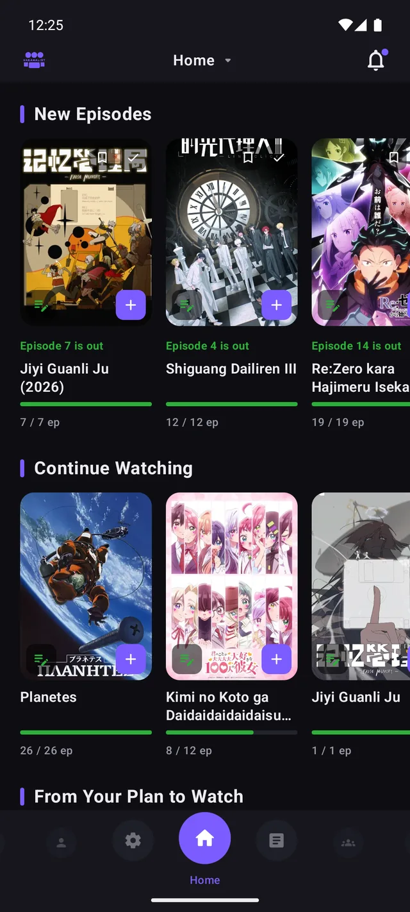
  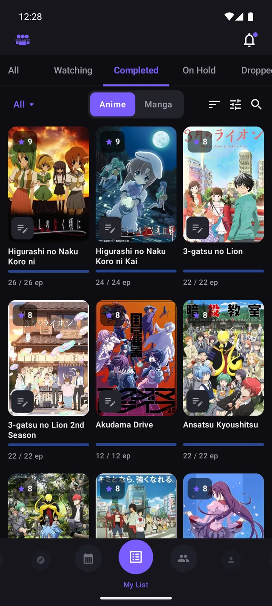
  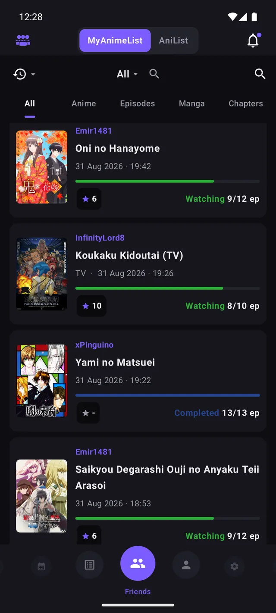
  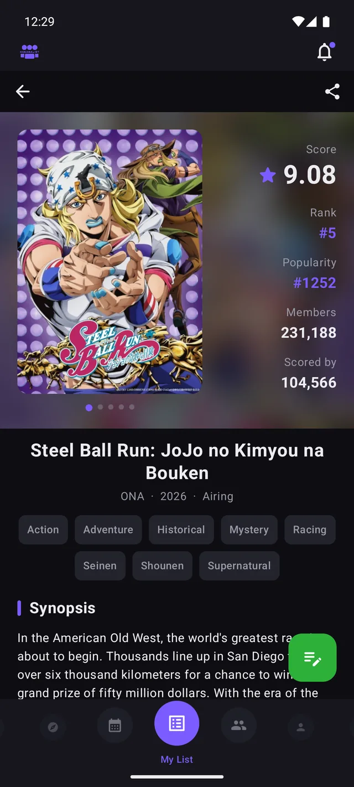
  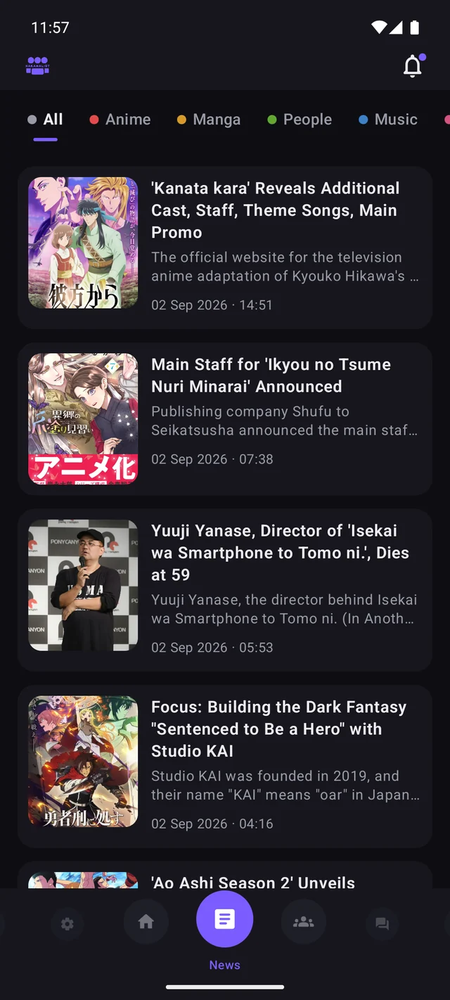
   
  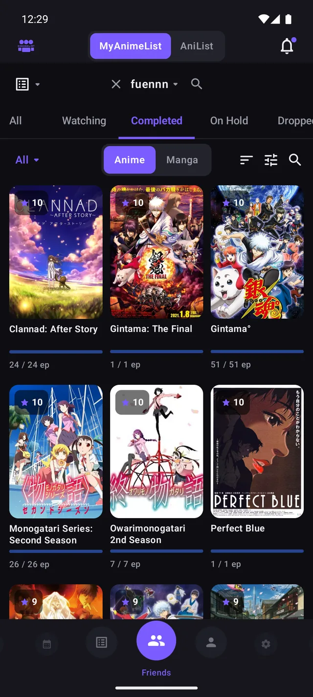
  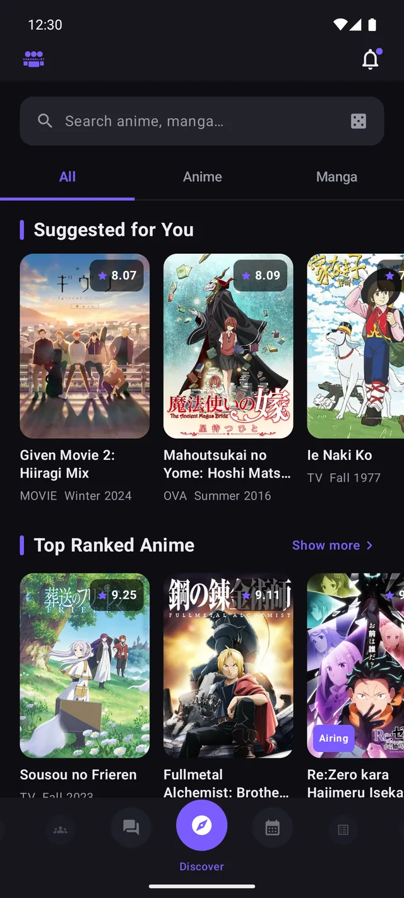
  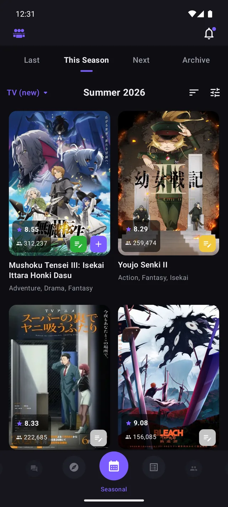
  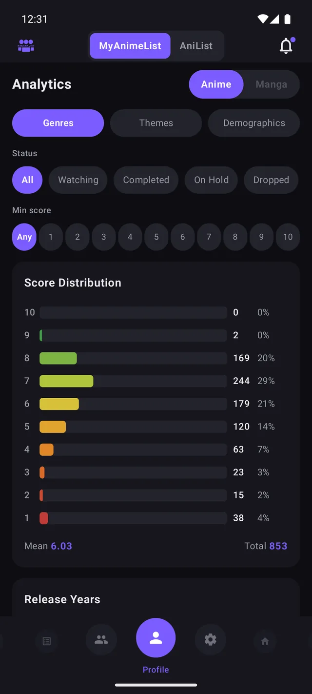
  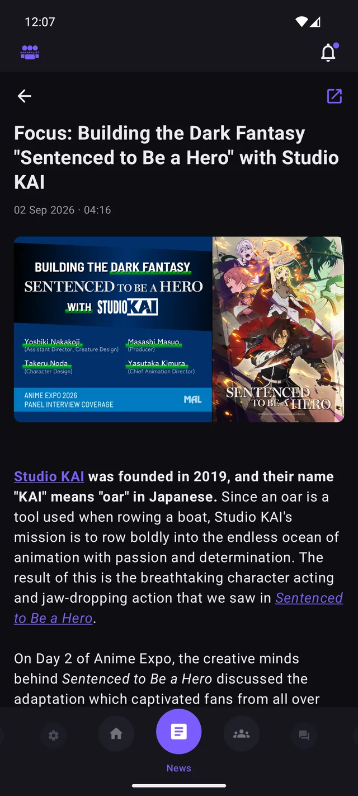
    
  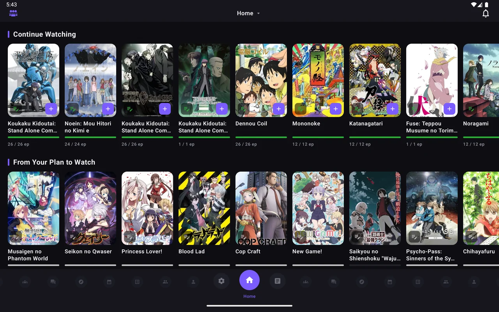
  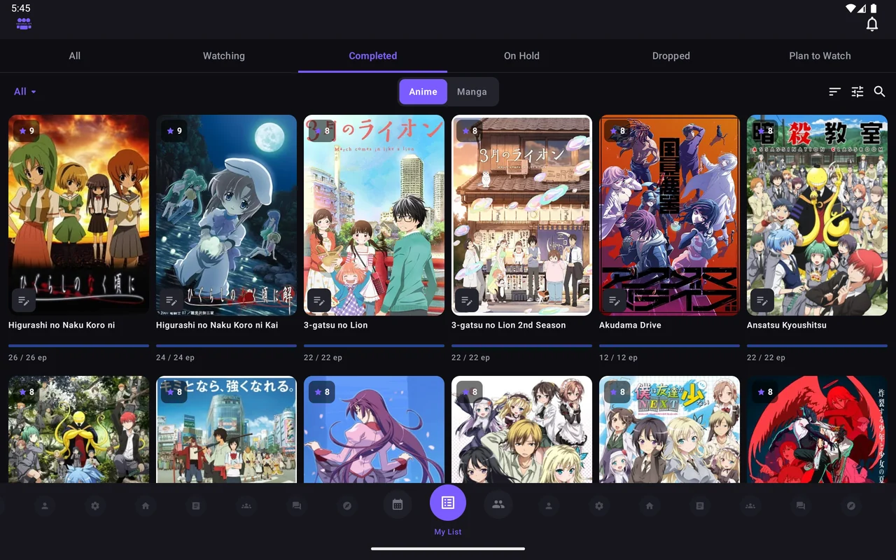
   
  On a tablet the app uses the whole screen in landscape.

## Features

You can sign in with MyAnimeList, AniList or both. Each one works on its own. When both are linked, every
change you make on MyAnimeList is copied to AniList, and the Sync screen shows the differences between the
two lists before you apply them.

### Your lists

Edit everything MyAnimeList lets you edit: status, score, episodes and chapters, volumes, start and finish
dates, rewatch and reread counts, priority, tags and comments. The +1 button adds an episode in one tap,
and the change shows up on every screen right away.

Lists can be shown as rows or a poster grid, with status tabs, type filters and sorting. Scores can be out
of 10, out of 10 with decimals or out of 100, and titles can be in romaji or English.

Home shows what you're watching and reading, new episodes, your Plan to Watch and Plan to Read lists,
this season, and your own recent activity.

### Friends

Add friends by their MyAnimeList username or follow people on AniList. Their updates appear in one feed,
newest first, and you can filter it by anime, episodes, manga and chapters.

You can open a friend's anime and manga list and browse it the same way as your own. Every title page
shows what your friends scored it, next to your own score and their average.

Your friends list can be exported and imported, so you don't lose it when you change phones.

### Discover and community

Discover has the official rankings, Top Ranked Anime and Manga, Suggested for You, search, and a button
that opens a random top-ranked anime.

Title pages have the synopsis, score and rank, related and recommended titles, characters and staff with
their own pages, the trailer, opening and ending songs, and a discussion thread for every episode.

You can browse every anime season, read MyAnimeList news in the app, read the forums and browse clubs.
The app can notify you when a new episode of something you're watching comes out, or when there's news
about a title on your list.

### Settings

System, white and dark themes with an optional pure black mode, accent colours, a reorderable bottom bar
and home screen widgets for what you're watching and reading.

> [!IMPORTANT]
> No ads, no third-party analytics and no tracking. Your sign-in is stored encrypted on your device.
> Adult titles are hidden unless you turn them on.

## Download

*Free. You can browse without an account and sign in when you want to track.*

### Requirements

- **Android** 8.0 (API 26) or newer
- **Phones** in portrait
- **Tablets** with layouts that use the full screen
- **TV** on Android TV and Google TV, with its own launcher banner and full remote navigation
- **Account** on MyAnimeList or AniList to track; browsing works without one

### Languages

NakamaList is available in **56 languages**, including the right-to-left languages Arabic, Hebrew,
Persian and Urdu. You can change the language in Settings.

## Support

- **Found a bug?** [Report it](https://github.com/asa07-salihg/NakamaList/issues/new?template=bug_report.md). The template asks for your device, Android version and the steps.
- **Want a feature?** [Suggest it](https://github.com/asa07-salihg/NakamaList/issues/new?template=feature_request.md)
- **Anything else?** [nakamalist@proton.me](mailto:nakamalist@proton.me)

If you want to support development, there is a **Sponsor** button at the top of this page
(see [`FUNDING.yml`](FUNDING.yml)).

## Privacy and Terms

[Privacy Policy](PRIVACY_POLICY.md) · [Terms of Use](TERMS_OF_USE.md) · [Changelog](CHANGELOG.md)

## Legal

NakamaList is an independent project. It is **not** affiliated with, endorsed by, or officially
connected to MyAnimeList, AniList, or any related company. All trademarks and product names belong
to their respective owners.

## License

Copyright © 2026 Ahmet Salih Golen. All rights reserved. The NakamaList name, brand assets, and
documentation are proprietary; no license to reuse them is granted.

---

Built and maintained by <b>Ahmet Salih Golen</b> · <a href="https://github.com/asa07-salihg">@asa07-salihg</a>

<table><td>
<a href="#start-of-content">Back to top</a>
</td></table>

